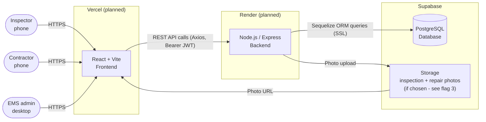

# Architecture Diagram

**Lift Spot-Check V2 (EMS problem statement 12b)** - planned. Hosting for the frontend and backend is not decided yet; Vercel and Render are shown because the lecturer's reference project uses them.

> Preview in VS Code with `Ctrl+Shift+V` (needs the *Markdown Preview Mermaid Support* extension recommended in `.vscode/extensions.json`). No extension? Open the image version: [images/architecture.png](images/architecture.png).

Flag 3 refers to [feature-dependencies.md](feature-dependencies.md#flags-for-team-discussion). If the team picks local disk instead, the Storage box goes away and photos are served by the backend.
