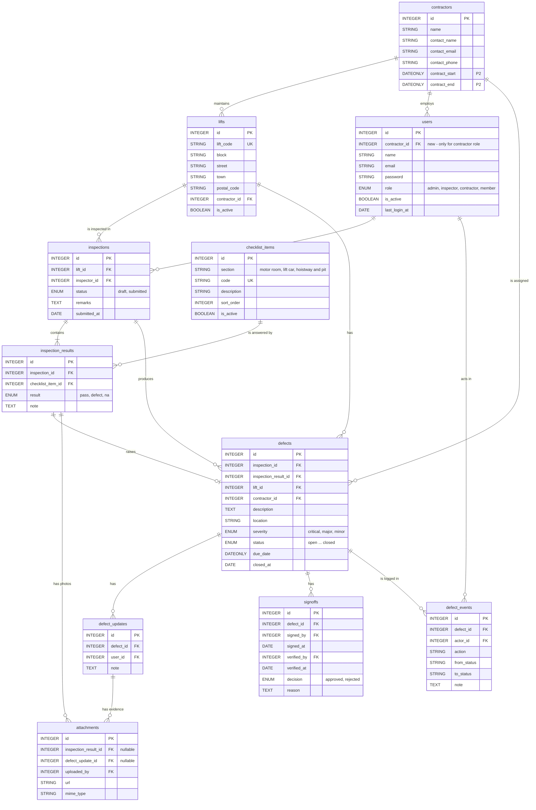

# ER Diagram

**Lift Spot-Check V2 (EMS problem statement 12b)**

Planned tables for the P0 and P1 features. `users` already exists; everything else is new and lands in one schema PR (see [feature-dependencies.md](feature-dependencies.md), Wave 0). Columns are snake_case, as in the migrations.

> Preview in VS Code with `Ctrl+Shift+V` (needs the *Markdown Preview Mermaid Support* extension recommended in `.vscode/extensions.json`). No extension? Open the image version: [images/er-diagram.png](images/er-diagram.png).

All tables also have `created_at` and `updated_at` (Sequelize `underscored: true`); they are left out above to keep the diagram readable.

## Who owns each table

| Table | Owner | Written by | Read by |
|-------|-------|-----------|---------|
| `users` (+ `contractor_id`) | Kwan | Kwan | Everyone |
| `contractors` | Kwan | Kwan | Everyone |
| `lifts` | Kwan | Kwan | Everyone |
| `checklist_items` | Kandha | Seed only | Kandha |
| `inspections` | Kandha | Kandha | Si Qi (reports), Kwan (audit) |
| `inspection_results` | Kandha | Kandha | Si Qi (defect creation) |
| `defects` | Si Qi | Si Qi's `transition()` only | Everyone |
| `defect_updates` | Jerald | Jerald | Si Qi (history) |
| `attachments` | Jerald | Jerald's upload service (used by Kandha too) | Everyone |
| `signoffs` | Jerald | Jerald | Si Qi (history) |
| `defect_events` | Kwan | Si Qi's `transition()` via Kwan's `logEvent()` | Si Qi, Jerald (history screens) |

Design note: `attachments` uses two nullable foreign keys instead of one polymorphic `owner_type` / `owner_id` pair, so the database can enforce both links.
