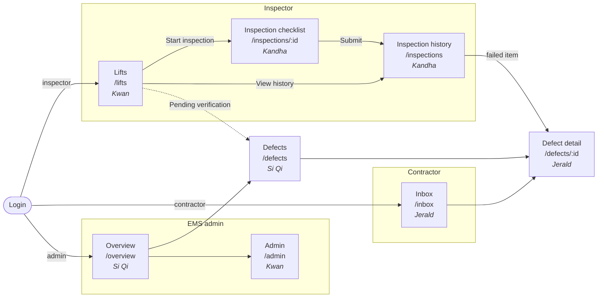

# Screens and Navigation

**Lift Spot-Check V2 (EMS problem statement 12b)**

8 pages plus login, against about 13 in Prototype 2 - this is our answer to "fewer pages". Wireframes are drawn at phone width (390px) because the inspector and contractor use phones; admin pages also work on desktop.

> Preview in VS Code with `Ctrl+Shift+V` (needs the *Markdown Preview Mermaid Support* extension recommended in `.vscode/extensions.json`). No extension? Open the image version: [images/navigation-map.png](images/navigation-map.png).

---

## Navigation Map



| Page | Route | Roles | Owner | Home for |
|------|-------|-------|-------|----------|
| Login | `/login` | Everyone | Group (done) | - |
| Lifts | `/lifts` | inspector, admin | Kwan | inspector |
| Inspection checklist | `/inspections/:id` | inspector | Kandha | - |
| Inspection history and report | `/inspections` | inspector, admin | Kandha | - |
| Defects | `/defects` | admin, inspector | Si Qi | - |
| Defect detail | `/defects/:id` | admin, inspector, contractor (own company only) | Jerald | - |
| Inbox | `/inbox` | contractor | Jerald | contractor |
| Overview | `/overview` | admin | Si Qi | admin |
| Admin | `/admin` | admin | Kwan | - |

Every page above is routed, guarded and in the nav already (skeleton PR), and `ROLE_HOMES` in `frontend/src/router/routes.js` matches the "Home for" column. Members (self sign-up) land on `/dashboard`.

---

## Wireframes

### Lifts - Kwan (F01.1, F01.2, F01.13)

```
┌──────────────────────────────────┐
│ Lifts                    [Menu]  │
├──────────────────────────────────┤
│ [ Search lift ID, block, street ]│
│                                  │
│ ┌──────────────────────────────┐ │
│ │ LIFT-0427   Blk 512 Lift A   │ │
│ │ Hougang Ave 10               │ │
│ │ Contractor: Apex Lifts       │ │
│ │ Last check: 3 Nov - 2 open   │ │
│ │ [Start inspection] [History] │ │
│ │ Find in map                  │ │
│ └──────────────────────────────┘ │
│ ┌──────────────────────────────┐ │
│ │ LIFT-0428   Blk 512 Lift B   │ │
│ │ ...                          │ │
│ └──────────────────────────────┘ │
│                                  │
│ 3 repairs waiting for you ->     │
└──────────────────────────────────┘
```

### Inspection checklist - Kandha (F01.3-F01.10)

One scrolling page - no steps, no popups. Lift and inspector come from the record and the login, not typed.

```
┌──────────────────────────────────┐
│ <- LIFT-0427  Blk 512 Lift A     │
│ Apex Lifts - You - 12 Nov 10:42  │
├──────────────────────────────────┤
│ Motor room            [All Pass] │
│ 1 Machine brake    [Pass][Defect]│
│ 2 Controller panel [Pass][Defect]│
│ ...                              │
│ Lift car              [All Pass] │
│ 9 Door sensor      [Pass][DEFECT]│
│  ┌────────────────────────────┐  │
│  │ What's wrong? [__________] │  │
│  │ Severity [Critical|Major|  │  │
│  │           Minor]           │  │
│  │ [+ Photo]                  │  │
│  └────────────────────────────┘  │
│ ...                              │
│ Hoistway and pit      [All Pass] │
│ ...                              │
├──────────────────────────────────┤
│ 24/25 answered                   │
│ [Save draft]   [Submit]          │
└──────────────────────────────────┘
```

### Inspection history and report - Kandha (F01.11, F01.12, F05.3)

```
┌──────────────────────────────────┐
│ Inspections         [Export CSV] │
├──────────────────────────────────┤
│ Lift [All v]  From [__] To [__]  │
│                                  │
│ INS-000231  LIFT-0427  12 Nov    │
│ 24 pass - 1 defect     [Report]  │
│ INS-000219  LIFT-0428  3 Nov     │
│ 25 pass                [Report]  │
│ ...                              │
└──────────────────────────────────┘
```

### Defects - Si Qi (F02.3, F02.8, F02.9, F05.4)

```
┌──────────────────────────────────┐
│ Defects             [Export CSV] │
├──────────────────────────────────┤
│ Contractor [All v] Status [All v]│
│ Severity [All v]  [ ] Overdue    │
│                                  │
│ Apex Lifts (4)                   │
│  DEF-000088 LIFT-0427 Door sensor│
│  Major - due 19 Nov - Open       │
│  DEF-000081 LIFT-0311 Brake      │
│  Critical - OVERDUE 2d - In prog │
│ Summit Elevators (2)             │
│  ...                             │
└──────────────────────────────────┘
```

### Inbox - Jerald (F03.2)

```
┌──────────────────────────────────┐
│ Apex Lifts - Inbox       [Menu]  │
├──────────────────────────────────┤
│ [New 2] [In progress 3] [Done]   │
│                                  │
│ ┌──────────────────────────────┐ │
│ │ DEF-000088  Major            │ │
│ │ LIFT-0427 Blk 512 - Door     │ │
│ │ sensor not responding        │ │
│ │ Due 19 Nov (7 days)          │ │
│ │ [Acknowledge]                │ │
│ └──────────────────────────────┘ │
│ ┌──────────────────────────────┐ │
│ │ DEF-000081  Critical OVERDUE │ │
│ │ ...                          │ │
│ └──────────────────────────────┘ │
└──────────────────────────────────┘
```

### Defect detail - Jerald (F03.3-F03.10)

The same page serves the contractor (do the work) and the inspector (verify it). Buttons depend on role and status.

```
┌──────────────────────────────────┐
│ <- DEF-000088   [In progress]    │
├──────────────────────────────────┤
│ LIFT-0427 Blk 512 Lift A         │
│ Door sensor not responding       │
│ Major - due 19 Nov - Apex Lifts  │
│ [inspector photo]                │
│                                  │
│ History                          │
│ 12 Nov  Opened by Tan (inspector)│
│ 13 Nov  Acknowledged by Lim      │
│ 14 Nov  "Sensor ordered" - Lim   │
│                                  │
│ ── Contractor ─────────────────  │
│ Note [__________________]        │
│ [+ Photo evidence]               │
│ [x] I confirm the work is done   │
│ [Post update]  [Sign off]        │
│                                  │
│ ── Inspector (after sign-off) ── │
│ [Approve]  [Reject - reason]     │
└──────────────────────────────────┘
```

### Overview - Si Qi (F08.1-F08.4)

Four counts only - no charts or analytics (the prototype review warned against them).

```
┌──────────────────────────────────┐
│ Overview          [This month v] │
├──────────────────────────────────┤
│ ┌─────────────┐ ┌─────────────┐  │
│ │ Open        │ │ Overdue     │  │
│ │ 14          │ │ 3           │  │
│ └─────────────┘ └─────────────┘  │
│ ┌─────────────┐                  │
│ │ Inspections │                  │
│ │ 42          │                  │
│ └─────────────┘                  │
│                                  │
│ By contractor   Open  Overdue    │
│ Apex Lifts        6      2       │
│ Summit Elevators  5      1       │
│ ...                              │
└──────────────────────────────────┘
```

### Admin - Kwan (F04.1-F04.5, F05.1, F05.2, F05.5)

```
┌──────────────────────────────────┐
│ Admin                            │
├──────────────────────────────────┤
│ [Lifts] [Contractors] [Users]    │
│ [Import]                         │
│                                  │
│ Import lifts                     │
│ [Download template]              │
│ [Choose .csv / .xlsx]  [Upload]  │
│                                  │
│ Result: 118 accepted, 2 rejected │
│  Row 14  Duplicate LIFT-0427     │
│  Row 52  Missing contractor      │
└──────────────────────────────────┘
```

The names, dates and numbers in these wireframes are made-up examples to show layout, not real EMS data.
