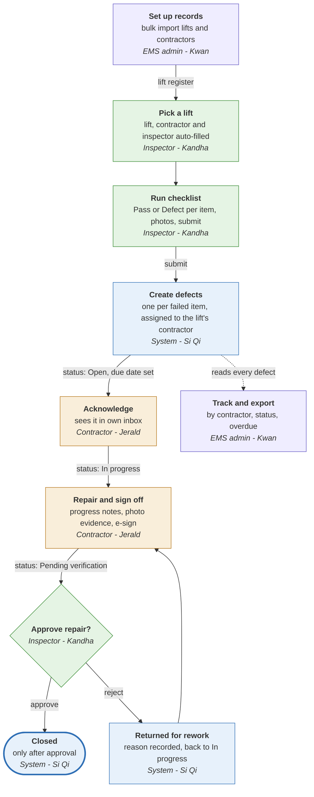
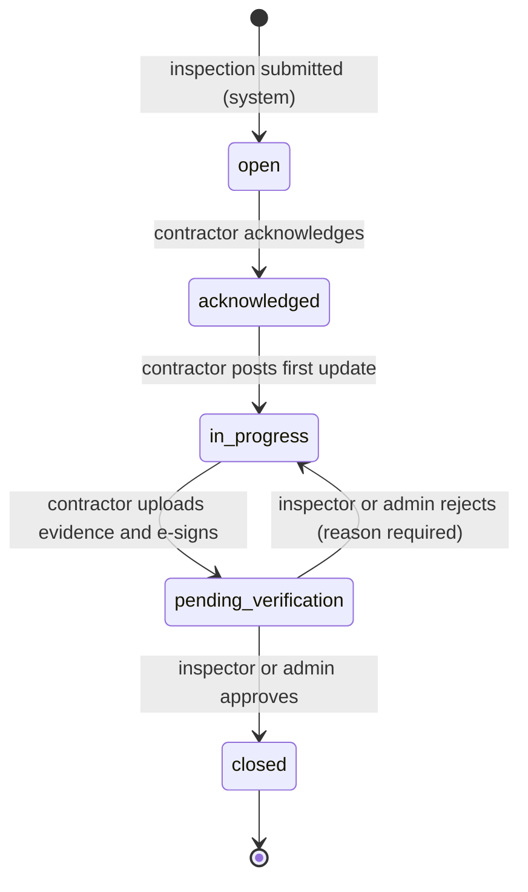

# Workflow Diagram

**Lift Spot-Check V2 (EMS problem statement 12b)**

How one spot-check becomes a closed defect, and which teammate owns each step. Each colour is one person's slice, so every arrow between two colours is an API two people must agree on before coding.

> Open this file with **Markdown: Open Preview** (`Ctrl+Shift+V`) in VS Code. The diagrams need the *Markdown Preview Mermaid Support* extension - VS Code offers it automatically because it is listed in `.vscode/extensions.json`. GitHub renders them without any extension. Image versions: [images/workflow.png](images/workflow.png), [images/defect-status.png](images/defect-status.png).

---

## End-to-end flow

| Colour | Owner |
|--------|-------|
| Purple | Kwan - EMS admin, records, import |
| Green | Kandha - inspector |
| Blue | Si Qi - defect system, overview |
| Amber | Jerald - contractor |

---

## Defect status lifecycle

A defect has five statuses. **Overdue is a flag, not a status**: `due_date < today` and status is not `closed`.

| From | To | Who | Must include |
|------|----|-----|--------------|
| (new) | `open` | System, on inspection submit | Failed item, lift's contractor, due date from severity |
| `open` | `acknowledged` | Contractor of that company | Timestamp |
| `acknowledged` | `in_progress` | Contractor of that company | First progress note |
| `in_progress` | `pending_verification` | Contractor of that company | Evidence photo and e-sign |
| `pending_verification` | `closed` | Inspector or admin | Approval |
| `pending_verification` | `in_progress` | Inspector or admin | Rejection reason |
| Any except `closed` | Same status, new contractor | Admin | Reassignment reason |

Rules every owner codes against:

- Every move writes one `defect_events` row (actor, time, action, from, to, note).
- All code changes status through Si Qi's `defectService.transition()`. Nobody updates `defects.status` directly.
- Contractor sign-off alone can never reach `closed` (F03.9).
